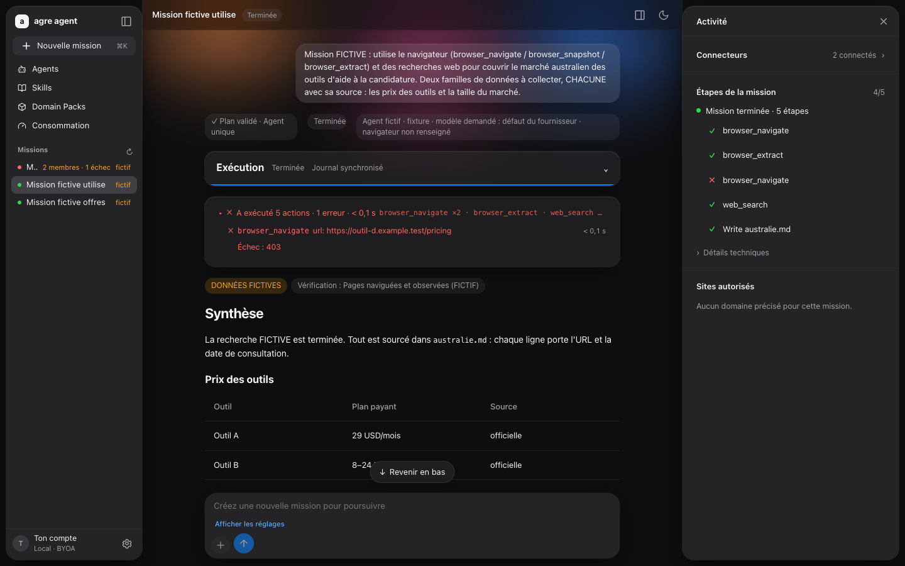
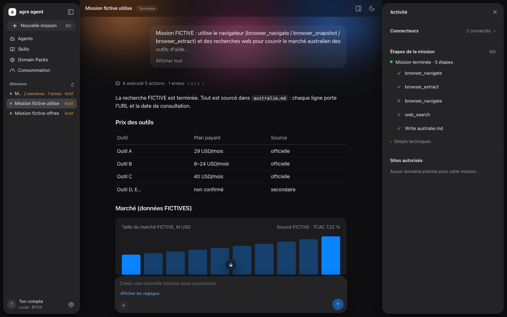
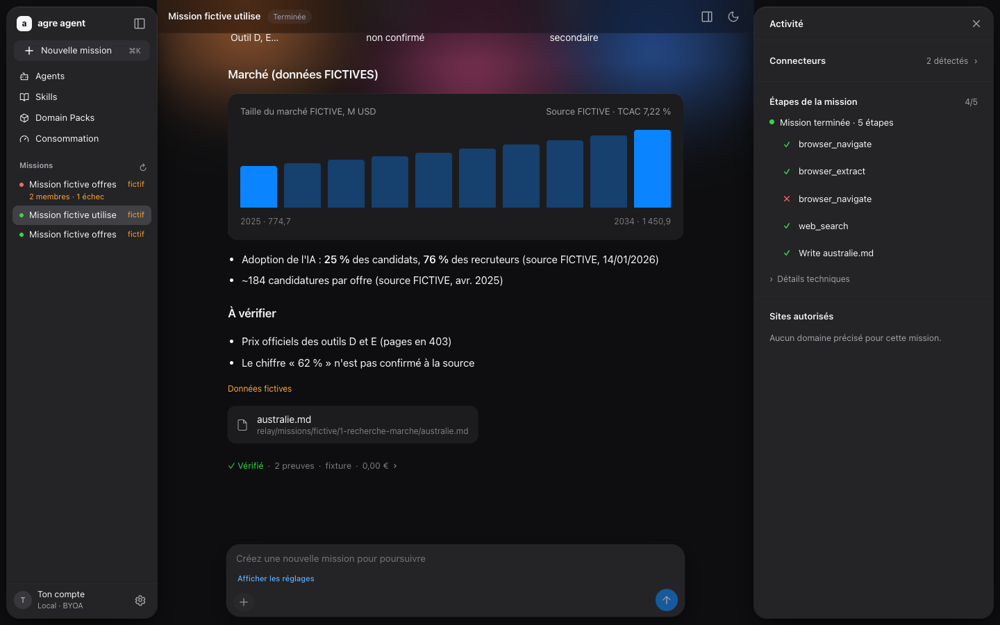
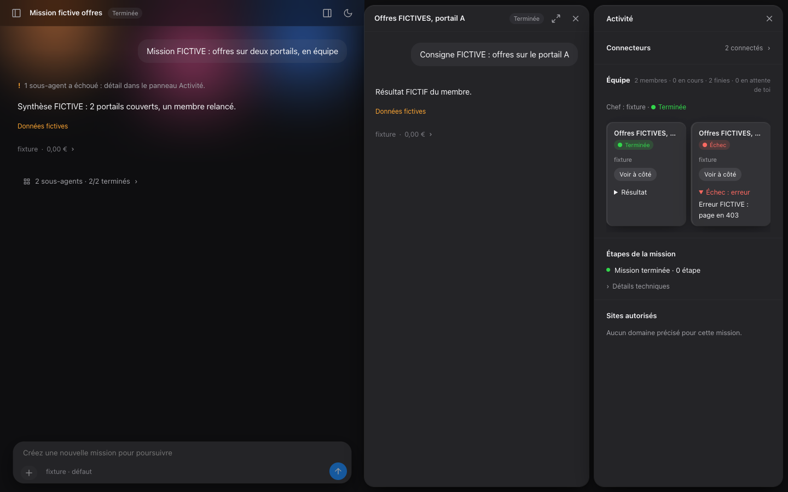
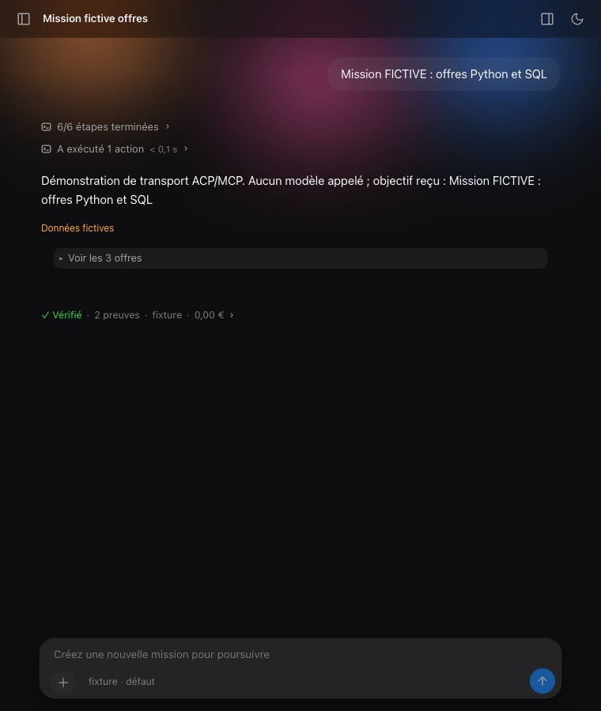

# Rapport reponse-04 : réponse de l'agent façon Claude Code, nouveau code d'équipe, panneaux multi-agents

Demande du propriétaire (21/11, 09:58) : le zip `agregat agent ai.zip` (Téléchargements) à implémenter, « la logique
multi-agentique, les panneaux, les différentes visions scindées », adapté au nouveau code, puis pousser pour voir le
rendu. Brief principal : `BRIEF-conversation-reponse-04` (collé dans le message, copié dans `docs/`), maquette
`Conversation agent v5.dc.html`. Branche `claude/bold-goldstine-171eb9`, commits `[reponse-04]`.

## Aperçu (thème sombre, données FICTIVES)
Réponse d'agent, avant puis après (1440 px) :




Bas de la réponse après (fichier produit, ligne méta, composer à un seul bouton) :



Équipe dans le panneau et vue scindée (un membre suivi à côté du fil de sa mission) :



Mission workflow à 760 px :



## En bref
- **Nouveau code** : la chaîne front `equipe-front-20-11` → `swarm-09` → `swarm-11` (équipe d'agents, écrite pour le
  contrat d'équipe du back `swarm-20-11`) est **fusionnée** dans la branche (fusion, pas de réécriture). Conflits
  résolus en faveur de `swarm-11`, qui suit le back.
- **Brief 04** : réponse en texte d'abord (`src/RunTurn.tsx`), graphiques ```chart (`src/Chart.tsx`), tableaux GFM
  défilants, ligne d'activité et ligne méta repliables, incident en ligne, cartes de fichiers, bulle à 170 caractères,
  composer à un seul bouton, bouton rond « Revenir en bas », mesures de la v5. Prompt système : règle de forme sur une
  **branche back locale** `reponse-04-format` (non intégrée, non poussée).
- **Multi-agents et vues scindées** : l'équipe (logique de `swarm-11`) vit dans le panneau Activité en tuiles, avec
  « Voir à côté » (un membre suivi en direct dans une **vue scindée** à côté du fil de sa mission) et « Arrêter ».
- **Aussi** : brief 02 (étapes d'un workflow en une ligne, « Données » dans les détails, journal brut dans le panneau,
  accords d'étape dans la réponse) et `skill-chip-01` (pastille de skill, lueur à trois trajectoires).
- **Vérifié (21/11, 11:40)** : `npm test` 396/396, `npm run build` OK, `prettier` OK, **e2e 18/18** contre le back
  `swarm-20-11` à jour (`35af485`, avec `swarm-14`, `15` et `16`), captures « après » refaites. **Non vérifié** : aucun
  vrai agent lancé ; suite complète du back non lancée.

## Journal
- 09:58 Zip extrait dans un dossier vide du scratchpad : dossier de passation `design_handoff_conversation_agent/`
  (README, briefs 02, 03, 04, `skill-chip-01`, maquettes v4, v5, `.dc`, Standalone, captures, `support.js`). Brief 03
  identique à celui déjà fait.
- 10:00 Nouveau code trouvé : branches front `equipe-front-20-11` (20/11), `swarm-09` et `swarm-11` (21/11, 04:41),
  chaîne linéaire, même base `7b2716c` que ma branche, écrite par les lots du chantier « swarm » du manager. Plan du
  manager relu : plus aucun lot d'interface après `swarm-11` (vagues 7 à 10 côté back). Contrat lu :
  `~/Downloads/agregat-back-swarm/docs/api-equipe-vue.md` (`?equipe=1`, `equipe` sur la liste, `family[]` enrichi).
- 10:04 Fusion de `swarm-11` (`c714405`) : conflits dans `api.ts`, `types.ts`, `App.tsx`. Pris de `swarm-11` :
  interrupteur « Équipe d’agents » et accord séparé (ma case « Autoriser les sous-agents » du 19/11 retirée), types
  d'équipe tolérants, liste sans sous-missions et résumé d'équipe. Gardés de ma branche : panneau Activité, journal des
  événements de délégation, titre et icône d'une sous-mission orpheline. 369 tests verts.
- 10:06 Passation design versée dans le dépôt (`06ab3cb`) ; brief 04 copié dans `docs/`.
- 10:09-10:12 Captures « avant » (`11c9eca`), back `~/Downloads/agregat-back-swarm` (`e7f4964`) chargé en lecture
  seule dans mon processus, base temporaire, agent `fixture`, hors réseau. `git status` du back inchangé.
- 10:13 Tests rouges (`93f18d9`) : `Test Files 2 failed | 24 passed (26)`, `Tests 2 failed | 370 passed (372)` ; le
  fichier du composant échoue à l'import de `./RunTurn` (sortie : `reponse-04/tests-rouges.txt`).
- 10:15-10:25 Implémentation, puis 12 tests à adapter (liste plus bas) ; 390 verts. Commits `aef5300` (graphique),
  `9e66f68` (CSS), `ffddb15` (réponse, équipe, vue scindée).
- 10:27 Manque vu en lisant l'e2e : une mission workflow n'a pas d'appels d'outils, donc rien ne montrait ses étapes.
  Ajout de la ligne « Étape i/n · titre » du brief 02, avec son test, et adaptation de l'e2e (`abe31db`).
- 10:31-10:35 Back : branche locale `reponse-04-format` (voir plus bas).
- 10:36 Sorties finales et captures « après » (`4fffd89`).
- 10:40 Défaut vu sur capture : une ligne méta dépliée sur une mission restait dépliée sur la suivante. Clé par
  mission. Le premier essai donnait à `RunTurn` la même clé que sa bulle voisine, et le test a attrapé le doublon.
  Clés préfixées, test ajouté.

- 10:45-11:05 E2E complet contre le back `swarm-20-11` (`AGENT_PLATFORM_BACKEND_DIR=~/Downloads/agregat-back-swarm`).
  Une première passe était faussée : les tests en mode dev servent la source, que j'ai modifiée pendant la passe. Elle
  a été arrêtée et relancée. Corrigé ensuite :
  - **vrai manque** : la perte du flux en direct ne se voyait plus (l'état était dans l'ancienne carte « Exécution ») ;
    `RunTurn` montre maintenant « ! Connexion perdue · reconnexion… » tant qu'elle dure ;
  - sélecteurs e2e de l'ancien affichage (`.approval`, `.results`, `.session-settings`), journal brut lu après
    l'ouverture de son pli, reconnexion native attendue avant l'assertion `Last-Event-ID`.

  Résultat : **17/18**. Reste rouge « défilement FICTIF : le composeur ne boucle pas après une petite remontée » : le
  composeur ne passe pas en compact après une remontée de 65 px. **Non diagnostiqué**, point ouvert n° 10. Sortie :
  `reponse-04/e2e-complet.txt` (passe à 16/18, avant la correction du test SSE).
- 11:10 Reprise après compactage. Back relu : `swarm-20-11` est passé de `e7f4964` à `35af485` (lots `swarm-14`
  consommation annoncée, `swarm-15` leçons durables, `swarm-16` niveaux de modèle). Docs `api-delegation.md` et
  `api-lecons.md` relues. Rien de cassé côté front (événements inconnus ignorés, sans nom technique affiché).
- 11:15 E2E « défilement » diagnostiqué par un script de mesure (scratchpad) : à 1550 px tout marche ; à 375 px la roue
  ne produit aucun événement de défilement du fil. Cause : le panneau Activité, ouvert d'office en large, restait ouvert
  et couvrait le fil sous 760 px (surcouche pleine largeur). Test rouge dans `activity-panel-app.test.tsx`, puis
  correction dans `App.tsx` : le panneau se ferme quand la fenêtre passe sous 760 px. E2E seul : vert.
- 11:20 Suivi du contrat du back : tests rouges puis verts pour l'événement `usage` (ligne « Annoncé par l’agent » du
  détail de la ligne méta, via `texteAnnonce` dans `status.ts`) et `lecon_gardee` (journal). Commit `7ffb8b4`.
- 11:25-11:40 `npm test` 396/396, build, prettier ; **e2e complet 18/18** (sortie : `reponse-04/e2e-complet.txt`) ;
  captures `front-01-screens/` d'un ancien rapport, réécrites par l'e2e, remises ; captures « après » refaites (la
  ligne méta est bien repliée dans la vue scindée).

## Ce qui disparaît du fil, ou change de place (étape 1 du brief)
| Avant (dans le fil) | Après |
|---|---|
| Rangée de badges (« Plan validé », agent, provenance, session ACP, accord de mission) | supprimée ; provenance et session dans la ligne méta dépliée et dans `trackerDetails` (« Données ») ; l'accord de mission devient une ligne d'incident tant qu'il est actif |
| Carte « Exécution » avec barre de progression, « L’agent travaille… », « Journal en direct » | une ligne repliable « A exécuté N actions · durée » (agent) ou « Étape i/n · titre » (workflow) ; le journal brut va dans le panneau, Détails techniques |
| Badges de résultat (« Résultat agent », « Analyse », « Vérification », « DONNÉES FICTIVES ») et titre « Synthèse » | supprimés ; « Données fictives » reste en petit sous la réponse ; la vérification passe dans la ligne méta |
| Cartes d'offres (`offer-grid`) et tableau | un tableau replié « Voir les N offres » |
| Carte « Éléments de preuve », « Autres pages lues » | dans la ligne méta dépliée (« Preuves », pli « Voir les preuves ») |
| `UsageCard` (Coût / Votre agent / Registre en 3 colonnes) | la ligne méta « ✓ Vérifié · N preuves · agent · coût », dépliée en clé/valeur |
| Carte d'erreur et bannière rouge « Impossible de terminer l’action » | une ligne « ! » discrète ; la bannière reste seulement pour une mission bloquée qui attend l'utilisateur |
| Cartes d'accord d'étape | bandeau `.inline-approval` dans la réponse (mêmes appels, mêmes textes) |
| Bloc Équipe et Carnet d’équipe (`swarm-11`) | dans le panneau Activité |
| Pastilles du composer et « Réglages de cette session » | un seul bouton « agent · modèle » qui déplie les réglages |
| Note d'aide sous le composer | supprimée |
| « ↓ Revenir en bas » (texte) | bouton rond de 32 px, flèche seule, nom accessible inchangé |

`RunView` (`src/Mission.tsx`) n'est plus rendu dans le fil, mais reste exporté : ses tests et les détails de
`CareerThread` s'en servent.

## Fichiers
- Ajoutés :
  - `src/RunTurn.tsx` : réponse, ligne d'activité, ligne d'étapes, incident, fichiers, ligne méta, accords d'étape, offres ;
  - `src/Chart.tsx` : `parseChart` et `Chart` (barres en HTML, courbe en SVG) ;
  - `src/SidePane.tsx` : vue scindée ;
  - `scripts/reponse-04-captures.mjs` ;
  - tests `src/reponse-04.test.tsx` et `src/reponse-04-app.test.tsx`.
- Modifiés :
  - `src/Markdown.tsx` : ```chart, tableaux défilants ;
  - `src/App.tsx` : `RunTurn`, incident en ligne, ligne méta, bouton rond, vue scindée, panneau avec l'équipe ;
  - `src/Career.tsx` : exports, `SkillChip`, `actionsDuration` ;
  - `src/Mission.tsx` : `provenanceText` ;
  - `src/Tracker.tsx` : ligne « Données » ;
  - `src/PromptBubble.tsx` : coupe à 170 caractères ;
  - `src/Composer.tsx` : menu de session, plus de note ;
  - `src/Team.tsx` : « Voir à côté », « Arrêter » ;
  - `src/ActivityPanel.tsx` : équipe, carnet, journal brut ; mes tuiles du 19/11 retirées ;
  - `src/Icon.tsx` : `expand` ;
  - `src/v2.css` ;
  - `tests/e2e.test.mjs`.
- Versés : `design_handoff_conversation_agent/` (zip) et `docs/BRIEF-conversation-reponse-04.md`.
- Supprimé : rien en fichier ; dans le code, les tuiles `FamilyTile` du 19/11 et leurs règles CSS, l'ancienne règle
  `.meta-line` (un bouton), `@keyframes v2-drift`.

## Tests
Ajoutés (`src/reponse-04.test.tsx`, 19 ; `src/reponse-04-app.test.tsx`, 4) :
- markdown avec tableau GFM, dans un conteneur qui défile ;
- ```chart valide en barres, avec le nombre de barres, les barres accentuées, la source et les deux bornes ;
- ```chart de type `line` en courbe ;
- ```chart invalide (JSON cassé, type inconnu, longueurs différentes, valeurs non numériques) en code brut, sans erreur visible ;
- ligne méta repliée puis dépliée en clé/valeur ;
- ligne d'activité repliée puis ✓ et ✕ ;
- étapes d'un workflow « Étape 2/3 · Relire » ;
- aucun badge, ni carte Exécution, ni Synthèse, ni coût en colonnes ;
- carte de fichier produit ;
- ordre activité → texte → fichiers → méta ;
- « Données fictives » ;
- incident en ligne, jamais en `role=alert` ;
- pastille de skill : visible 1,6 s puis cachée, rallumée par un nouvel appel, cachée pendant un accord et une fois la mission finie ;
- bulle tronquée, puis « Afficher tout » / « Réduire » ; message court sans bouton ;
- composer d'une mission : un seul bouton, pas de note ;
- lueur à trois trajectoires ;
- mesures de la v5 ;
- application : action en échec en ligne, pas en bannière ;
- application : mission bloquée qui garde la bannière (vert dès le départ, protège le comportement à garder) ;
- application : une seule réponse, sans badges ;
- application : ligne méta repliée à chaque mission.

Ajoutés pour l'équipe et la vue scindée :
- `src/sous-agents.test.tsx` : équipe dans le panneau, avec « Voir à côté », « Ouvrir » et « Arrêter » pour un membre en cours seulement ; « Arrêter » inactif pendant une action ; carnet dans le panneau ;
- `src/sous-agents-app.test.tsx` : « Arrêter » annule ce membre seulement, « Ouvrir » l'affiche en grand ; vue scindée (le membre à côté, la mission toujours dans le fil, barre latérale effacée, fermeture) ; « Ouvrir en grand ».

Adaptés, un par ligne :
- `swarm-11.test.tsx` « ouvrir une mère montre toujours son bloc Équipe… » : ouvre le panneau avant de chercher la région « Équipe », désormais dans le panneau.
- `swarm-11-relecture.test.tsx` « une sous-mission ouverte depuis le bloc Équipe… » : joué à 1440 px, où le panneau est ouvert et la barre latérale (la liste vérifiée) affichée.
- `front-anim.test.tsx` (bulle) : « Afficher tout » / « Réduire » au lieu de « Afficher plus » / « Afficher moins ».
- `activity-panel-app.test.tsx` « le résumé sous le résultat… » : la ligne méta se déplie sur place et n'ouvre plus le panneau (brief 04).
- `activity-panel-app.test.tsx` « la ligne des sous-agents… » : la section d'équipe s'appelle « Équipe » (bloc de swarm).
- `activity-panel.test.tsx` (vocabulaire) : une seule zone de détails techniques ; plus de tuile à déplier.
- `sous-agents.test.tsx` : les 5 tests de mes tuiles du 19/11, remplacées par le bloc Équipe, laissent place aux 3 tests ci-dessus.
- `sous-agents-app.test.tsx` : tests de la tuile remplacés par ceux du bloc Équipe. Après la fusion, retrait des tests de ma case (doublon de l'interrupteur de swarm) et barre latérale jouée sur une sous-mission orpheline (swarm retire de la liste une sous-mission dont la mère est listée).
- `tests/e2e.test.mjs` :
  - réponse unique au lieu de la carte « Exécution » ;
  - offres dans le tableau replié ;
  - registre dans la ligne méta ;
  - journal brut dans le panneau ;
  - ligne méta dépliée sur place ;
  - plus de note sous le composer.

## Back : règle de forme dans la consigne de l'agent (étape 5 du brief)
- Branche **locale** `reponse-04-format` (`c6aa540`), dossier `~/Downloads/agregat-back-reponse-04`, partie de
  `swarm-20-11` (`e7f4964`). **Non intégrée, non poussée** : le back a la priorité, le manager l'intègre s'il veut.
- `packages/orchestrator/answer-format.js` : `ANSWER_FORMAT_RULE`. Elle demande une phrase d'ouverture ; des titres, des
  listes et des tableaux markdown ; une section « À vérifier » ; un bloc ```chart (JSON `type`, `title`, `source`, `x`,
  `y`, `highlight`) pour une série chiffrée de 4 valeurs ou plus ; un tableau pour une comparaison. Elle est ajoutée
  après `WORK_FILES_RULE` dans `packages/orchestrator/index.js` (3 lignes).
- `tests/reponse-04-format.test.js` : la règle, et sa présence dans la consigne réelle envoyée à un agent ACP factice,
  avec ou sans Skill (méthode de `consigne-fichiers-travail`).
- `tests/delegation-v2-01-b.test.js` adapté : il prouve qu'une mission sans `multiAgent` est identique à la base
  `48a2f4e`. La règle, ajoutée exprès, est retirée avant la comparaison, après vérification qu'elle est bien présente.
  Tout le reste est toujours comparé mot pour mot.
- Lancés (`AGENT_PLATFORM_TEST_PHASE_TIMEOUT_MS=900000`) :
  - `reponse-04-format`, `consigne-fichiers-travail` et `delegation-v2-01-b` : 17/17 ;
  - les 11 fichiers qui lisent les consignes (`chef-01`, `doubt-tools`, `equipe-01-*`, `lecture-18-11`, `question-mal-formee`, `prompt-prime-18-11`, `review-precision-18-11`, `swarm-05-relecture`, `swarm-13-*`) : 168/168 ;
  - `prettier` OK.
- **Suite complète du back non lancée** (réservée au manager).

## Captures (`.manager/reports/reponse-04/`, thème sombre)
- Avant (18) : `avant-{terminee-workflow,reponse-agent,equipe}-{1440,924,760}-sombre.png` et `-haut.png`.
- Après (22) : mêmes noms en `apres-`. S'y ajoutent `apres-reponse-agent-*-deplie.png` (activité et méta dépliées) et
  `apres-equipe-1440-sombre-vue-scindee.png`. Refaites le 21/11 à 11:35, après la correction des clés (`90f9a98`).
- Commande : `npm run build && node scripts/reponse-04-captures.mjs avant|apres`. Données FICTIVES : la réponse riche
  et l'équipe sont écrites dans la base de mon back de test, la mission workflow est un vrai workflow fictif.

## Sortie `npm test`
Voir `reponse-04/npm-test.txt` (finale plus bas).

## Écarts et points ouverts
1. Le brief cite `docs/design/` ; dans ce dépôt, la passation vit dans `design_handoff_conversation_agent/` (structure du zip, et dossier du brief 03). Seul le brief 04 est copié dans `docs/`.
2. **Fichiers produits** : lus sur les appels d'outils terminés de l'agent (`kind: "edit"` et leur chemin), faute de champ du back. Pas de lien : aucune route ne sert un fichier du dossier de mission.
3. **Missions career-ops** : leur fil (`CareerThread`) n'est pas refondu ; seuls la ligne méta et l'incident en ligne s'y appliquent. À faire dans un lot suivant si tu le veux.
4. **Composer** : le bouton unique s'applique au composer d'une mission (maquette v5). Celui de l'accueil garde ses réglages, où l'on choisit agent et pack.
5. **Graphique** : types `bar` et `line`, 2 à 200 points, `x` et `y` de même longueur. Un bloc incomplet reste du code brut, sans message.
6. **Vue scindée** :
   - jusqu'à 1560 px, elle efface la barre latérale ;
   - jusqu'à 1340 px, elle prend la place du panneau (rouvrir le panneau la ferme) ;
   - sous 760 px, elle recouvre l'écran ;
   - un flux SSE de plus par vue ouverte.
7. **Équipe en tuiles** : c'est le bloc `TeamBlock` de swarm, en tuiles par la CSS. Ses textes et sa logique restent ceux testés par swarm. La tuile de la v4 avec « 3 dernières lignes d'activité » devient « dernière action … il y a … » et « depuis … », ce que donne le back.
8. **« Revenir en bas »** : rond, centré au-dessus du composer ; il peut chevaucher un bloc (32 px).
9. Les commits entre « tests rouges » et la fin ont des tests rouges par construction (méthode du brief).
10. ~~E2E « défilement FICTIF » rouge~~ : **corrigé le 21/11 à 11:20**. Ce n'était pas la logique `onScroll`. Le
    panneau Activité, ouvert d'office à 1550 px, restait ouvert quand la fenêtre passait à 375 px ; sous 760 px il
    devient une surcouche pleine largeur, qui cachait le fil (la roue faisait défiler le panneau). Il se ferme
    maintenant quand la fenêtre passe sous 760 px ; rouvert à la main à cette largeur, il reste ouvert.
11. **Vue scindée sous 760 px** : contrairement au panneau, elle ne se ferme pas quand la fenêtre rétrécit (c'est un
    choix explicite, avec son bouton « Fermer la vue à côté »). À changer si tu préfères le même comportement.
12. **Contrat du back du 21/11 au matin** (`swarm-14`, `swarm-15`, `swarm-16`, intégrés dans `swarm-20-11`, `35af485`) :
    - événement `usage` (jetons et coût annoncés par l'agent) : nouvelle ligne « Annoncé par l’agent » dans le détail de
      la ligne méta, chiffres et devise tels qu'annoncés, « non mesuré par la plateforme » ; absente sans chiffre ;
    - `lecon_gardee` : ligne « Leçon gardée pour les prochaines missions » dans le journal, sans l'identifiant ;
    - pas fait : niveau de modèle (`famille.niveau`, absent de `family[]`), écran des leçons (`GET /api/lecons`,
      `POST /api/lecons/…`) : nouvel écran, à décider.

## Questions
1. Faut-il refondre aussi le fil career-ops (CV, lettres, offres) sur ce modèle ?
2. La branche back `reponse-04-format` : l'intégrer dans `swarm-20-11` (manager) ?
3. Vue scindée : faut-il la garder, ou ouvrir plutôt le membre en grand ?
